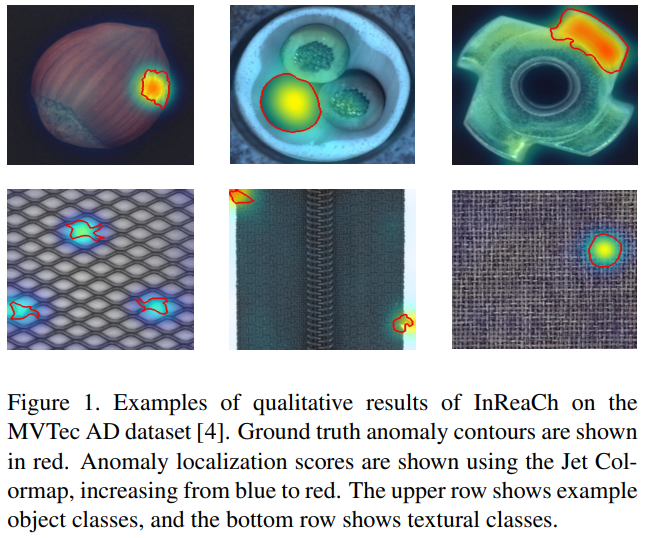
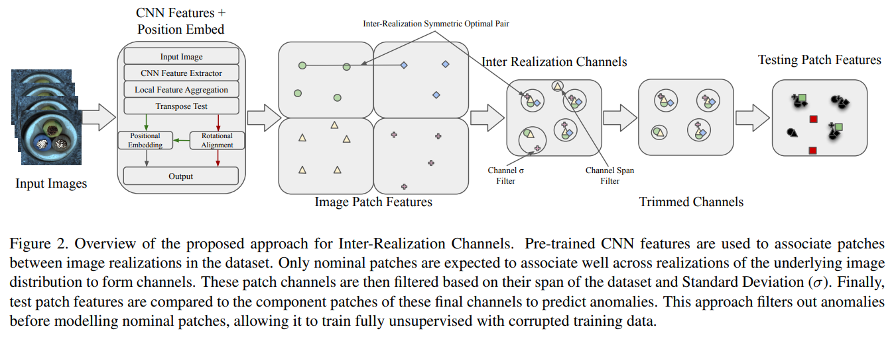
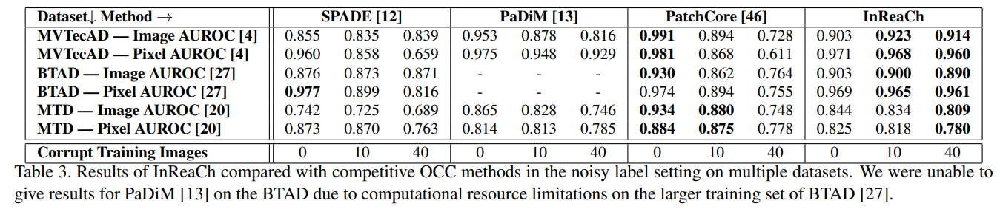

# Inter-Realization Channels (InReaCh): Unsupervised Anomaly Detection in Images Beyond One-Class Classification

This repository contains the implementation of **InReaCh**, a fully unsupervised method for anomaly detection and localization in images. The method was introduced in ICCV 2023 and achieves state-of-the-art performance in unsupervised anomaly detection tasks.

[Also check out the newer Online-InReaCh for better performance, tolerance to non-stationary distributions and online adaptation!](https://www.ecva.net/papers/eccv_2024/papers_ECCV/papers/07868.pdf)
[Online InReaCh code can be found here!](https://github.com/DeclanMcIntosh/Online_InReaCh)


## Overview

InReaCh leverages the concept of **Inter-Realization Channels** to extract high-confidence nominal patches from training data by associating them across image realizations. These nominal patches are used to build a model for detecting and localizing anomalies in test images. Unlike supervised one-class classification methods, InReaCh is fully unsupervised, simplifying dataset creation and broadening its applicability.

Key features of InReaCh:
- **Unsupervised anomaly detection**: No need for labeled training data.
- **High precision**: Achieves 99.9% precision in extracting nominal patches from the MVTec AD dataset.
- **Robust performance**: Maintains high accuracy even with up to 40% corrupted training data.
- **Competitive results**: Achieves 0.968 AUROC in localization and 0.923 AUROC in detection.

## Tables and Figures






## Repository Structure

- **`InReaCh.py`**: Main implementation of the InReaCh algorithm, including training and testing pipelines.
- **`FeatureDescriptors.py`**: Code for feature extraction and descriptor generation.
- **`mvtec_loader.py`**: Utilities for loading and preprocessing the MVTec AD dataset.
- **`utils.py`**: Helper functions for alignment, seeding, and positional tests.
- **`model.py`**: Code for loading and configuring the Wide ResNet-50 model for feature extraction.
- **`requirements.txt`**: Python dependencies for the project.
- **`conda_inreach.yml`**: Conda environment configuration file.
- **`images/`**: Contains visualizations of the method, results, and qualitative examples.
- **`data/`**: Placeholder for dataset-related files.

## Installation

### Using Conda
1. Clone the repository:
   ```bash
   git clone https://github.com/your-repo/InReaCh.git
   cd InReaCh
   ```

2. Create the Conda environment:
   ```bash
   conda env create -f conda_inreach.yml
   ```

3. Activate the environment:
   ```bash
   conda activate inreach
   ```

### Using Pip
1. Install the required Python packages:
   ```bash
   pip install -r requirements.txt
   ```

## Usage

### Dataset Preparation
Download the MVTec AD dataset and place it in the `data/` directory. The dataset should follow the structure expected by the `mvtec_loader.py` script.

### Running the Code
1. Train and test the InReaCh model:
   ```bash
   python InReaCh.py
   ```

2. Modify parameters such as `class_names`, `assoc_depth`, and `max_channel_std` in the `InReaCh.py` file to customize the training and testing process.

### Visualizing Results
The repository includes visualizations of the method and results in the `images/` directory:
- **`Method.png`**: Overview of the InReaCh methodology.
- **`Qualitative.png`**: Qualitative results of anomaly detection.
- **`Results.png`**: Quantitative results and performance metrics.

## Dependencies

The project requires the following key libraries:
- Python 3.12
- PyTorch 2.6.0
- torchvision 0.21.0
- OpenCV 4.11.0
- FAISS (GPU version)
- NumPy, SciPy, scikit-learn, tqdm

For a complete list of dependencies, refer to the `conda_inreach.yml` or `requirements.txt` file.

## Citation

If you use this code in your research, please cite the following paper:

```
@misc{mcintoshInReaCh,
      title={Inter-Realization Channels: Unsupervised Anomaly Detection in Images Beyond One-Class Classification},
      author={Declan McIntosh and Alexandra Branzan Albu},
      year={2023},
      booktitle = {Proceedings of the IEEE/CVF International Conference on Computer Vision (ICCV)},
      month     = {October}
}
```

## Acknowledgments

This implementation builds upon the concepts introduced in the ICCV 2023 paper. Special thanks to the authors and contributors for their work

